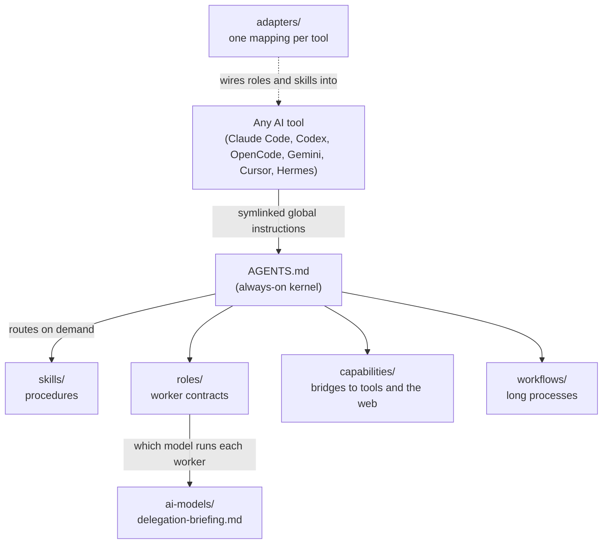

# agents/

**Everything about how I work with AI agents.** This is a frozen, public snapshot (October 13, 2026)
of the plain-text workspace that every AI tool I use reads before it does anything: Claude Code,
Codex, OpenCode, Gemini, Cursor and Hermes. It holds my rules, skills, worker roles, model choices,
tool bridges and the research behind them.

It is not a framework or a library. It is a working operating manual for a person who runs a lot of
AI agents every day, published so you can steal the parts that help.

## The idea in two sentences

1. **Every AI session starts as a new hire with zero context.** It does not know why the code looks
   the way it does, what was tried and rejected, or what "done" means. So the knowledge has to live
   in files, not in anyone's head or chat history.
2. **AI tools change every few months.** So the knowledge also cannot live inside any one tool's
   settings. It lives here, in plain Markdown, and each tool gets a thin adapter that points at it.
   Tools adapt to the workspace. The workspace never bends to a tool.

The long version, built on Peter Naur's "Programming as Theory Building" (1985), is in
[specs/agents-workspace/mission.md](specs/agents-workspace/mission.md).

## How it works

1. **One kernel, loaded everywhere.** Each tool's global instruction file (`~/.claude/CLAUDE.md`,
   `~/.codex/AGENTS.md` and so on) is a symlink to the same [AGENTS.md](AGENTS.md). It is kept
   short on purpose: who I am working for, where things live, and which file to read before which
   kind of action.
2. **Everything else loads on demand.** The kernel routes to a skill, a role or a capability only
   when the task needs it. This keeps the always-on context small, which keeps every session cheap
   and focused.
3. **Hard gates before writing.** Before an agent writes a report it must read
   [conventions/artifact-authoring.md](conventions/artifact-authoring.md). Before it touches durable
   memory it must read [conventions/memory-files.md](conventions/memory-files.md). These two files
   are why hundreds of AI-written documents stay findable and consistent.
4. **Git is the changelog.** Every meaningful change gets a commit whose message says *why*, not
   just what, and it gets pushed before the agent says it is done.

## How I use subagents

This is the part most people ask about. The short version: **the main agent is an architect, not a
typist.** It plans, splits work into small packets, hands them to cheaper workers in parallel, checks
what comes back, and owns the final answer.

- **Fixed roles, not ad hoc prompts.** Workers come in a small set of portable roles in
  [roles/](roles/): `task-explore` (read-only research), `task-execute` (one bounded edit), their
  `-high` versions for harder packets, and `task-orchestrator` for running one phase of a big job.
  [roles/task-worker-tiers.md](roles/task-worker-tiers.md) sets the rules: packet size, deadlines,
  how many run at once, and what a worker must hand back.
- **Workers never spawn workers.** One layer deep, always. This one rule prevents runaway agent
  trees and surprise bills. A child session launched through another tool's CLI counts against the
  parent's budget too.
- **One file picks every model.** [ai-models/delegation-briefing.md](ai-models/delegation-briefing.md)
  says, for each tool, which model runs each role, what that model is bad at, how often it guesses
  when it is wrong, and how many to run at once. No other file is allowed to choose a model, so
  there is nothing to drift.
- **Choices are backed by data.** [ai-models/](ai-models/) compares about 25 model and effort
  settings on price, speed and quality. [ai-models/EFFORTS.md](ai-models/EFFORTS.md) finds each
  model's "sweet spot" effort, the last setting before an extra point of quality gets several
  times more expensive.
- **Tools delegate to each other.** The `task-*` skills let one harness hand a bounded job to
  another one's CLI: Claude for hard reasoning, Codex or OpenCode for cheap parallel lookups, Gemini
  for video. Always on explicit request, never silently.

A real example from building this repo: one Opus session split the work into packets, ran six
Sonnet workers in parallel to clean different folders, gave each the same written brief, then
checked every claimed edit with its own scans before publishing.

## Folder guide

| Folder | What lives there | Start with |
|---|---|---|
| [AGENTS.md](AGENTS.md) | The always-on kernel every tool loads | Read it first |
| [INDEX.md](INDEX.md) | A shallow router to everything else | When you are lost |
| [skills/](skills/) | Step-by-step procedures loaded on demand | [skills/AGENTS.md](skills/AGENTS.md) |
| [roles/](roles/) | Portable worker contracts that tools expose as subagents | [task-worker-tiers.md](roles/task-worker-tiers.md) |
| [ai-models/](ai-models/) | Model data, effort sweet spots and who-runs-what | [delegation-briefing.md](ai-models/delegation-briefing.md) |
| [capabilities/](capabilities/) | Bridges to other CLIs, MCP servers, browsers and the web | [connectors.md](capabilities/connectors.md) |
| [adapters/](adapters/) | How each AI tool is wired to this workspace, and where it differs | [adapter-contract.md](adapters/adapter-contract.md) |
| [workflows/](workflows/) | Long processes: planning, tool onboarding, model bake-offs | [spec-workflow/](workflows/spec-workflow/) |
| [conventions/](conventions/) | Write-time rules: where files go, how memory works, permissions | [artifact-authoring.md](conventions/artifact-authoring.md) |
| [specs/](specs/) | Durable rules and research, a selection of the full set | [mission.md](specs/agents-workspace/mission.md) |
| [prompts/](prompts/) | Reusable prompt text that is not a skill or role | Mostly empty by design |

### skills/

Reusable procedures. Each is a folder with a `SKILL.md` and optional references.

- **Planning:** `plan-create`, `plan-execute` and `plan-reconcile` run serious work in three fresh
  sessions. The plan is written so a cold session, or a cheaper model, can pick it up from the files
  alone. Reconcile folds the result back into long-lived memory.
- **Research:** `research` and `research-deep` fan out read-only workers in rounds and always end
  with one saved report, so nothing is lost to chat scrollback. `spec-from-research` turns deep
  research reports into a spec with a digest per source.
- **Delegation across tools:** `task-claude`, `task-codex`, `task-gemini`, `task-hermes` and
  `task-opencode`. Each pins the model and effort, blocks nested subagents with a real flag, and
  checks the actual event log afterward instead of trusting the child's summary.
- **Browsers:** `browser-use` picks the right browser route first. `chatgpt-browser` and
  `claude-browser` drive those sites, including starting many deep-research chats at once and
  exporting them later. `browser-deep-research-prompts` writes those research prompt packs.
- **Upkeep:** `memory-reconcile` fixes drifted memory. `sync-tool-adapter` realigns one tool with the
  workspace. `model-bakeoff` runs head-to-head model comparisons. `role-dispatch` runs one role on a
  hand-picked model.

### roles/

Contracts, not prompts. A role says what a worker may read, what it may change, how big its packet
can be, and what its report must contain. It never names a model. Each tool's adapter maps the role
to a native subagent and a model, using the delegation briefing.

### ai-models/

The single source of truth for model choice. `delegation-briefing.md` is the per-tool scorecard.
`SELECTION.md` ranks value per dollar. `EFFORTS.md` finds effort sweet spots. `subscription-speed.md`
shows measured speeds (for example, Codex on a subscription ran 3 to 4 times slower than the API).
`scripts/` is plain standard-library Python that pulls and queries benchmark data. The raw
third-party data itself is not published.

### capabilities/

How agents reach the outside world, with exact commands, costs, failure modes and dated test
results. The CLI guides (`claude-cli.md`, `codex-cli.md`, `gemini-cli.md`, `opencode-cli.md`)
explain how one harness drives another headlessly. `web/` holds a 200-cell scorecard of which
search or fetch tool works for which kind of site, kept current by small Node scripts that log every
notable success or failure.

### adapters/

One mapping file and one "divergences" file per tool. The mapping says how roles, skills and
permissions are wired natively. The divergences file records where that tool deliberately differs,
with a date and a reason, so drift is written down instead of hidden. The `sync-tool-adapter` skill
keeps them honest, and it only ever touches one tool per run.

### workflows/

- `spec-workflow/`: the folder layout and templates behind the planning skills (`PLAN.md`,
  `SUBTASK.md`, `WORKER_RESULT.md`, `RECONCILE_PACKET.md` and more).
- `adapter-lifecycle/`: onboarding a new tool is treated as realigning an empty adapter. It starts
  with a read-only audit and a two-way ledger of everything that differs.
- `model-bakeoff/`: a fair, isolated benchmark contract for comparing models across tools.

### specs/

A selection of the durable rules and research specs. Each folder has a `spec.md` and often
`STATE.md` (where things stand), `DECISIONS.md` (what was chosen and rejected) and `SOURCES.md`
(evidence).

- **How the workspace runs:** `agents-workspace` (the mission), `agents-bootstrap`, `project-memory`,
  `spec-workflow`, `research`, `loose-ends`, `model-delegation`.
- **Research I found worth keeping:**
  - `llm-evals`: a full study of evaluating LLMs and agents, with a 15,000-word compendium and a
    plan to build a small eval loop for AI workers.
  - `internet-deep-research`: which search and fetch tools to use from each harness, plus a design
    for a tool-agnostic deep-research engine.
  - `browser-use`: a cross-tool safety contract for letting agents drive real browsers, backed by
    live tests.
  - `browser-deep-research`: scored benchmarks of ChatGPT and Claude research modes.
  - `youtube-extraction`: the best way to get a faithful transcript from a video, timed on real
    videos.
  - `web-scraping-site-access`: how agents can read public platforms and which data providers
    hold up.
  - `hermes-internet-deep-research`: getting web search and cited reports working in Hermes.

Every claim in these specs is tagged by how it is known: measured, documented by a vendor, claimed
by someone, or generated. Vendor marketing is never treated as proof.

## What is not here

This is a snapshot, not the whole thing. Left out on purpose:

- **Private memory:** project notes, in-progress change folders, generated reports and personal
  material. Where a file mentions them you will see "(private, not published)".
- **Third-party content:** word-for-word copies of articles, videos and benchmark data that the
  research was built from. The specs keep the summaries and the original public links.
- **Secrets:** none were ever stored here. Keys are referenced by environment variable name only.

Some paths say `~/agents` or `~/agents-workspace`: that is where the live workspace sits on my
machine.

## Using it yourself

You do not need all of it. Good places to start:

1. **Copy the kernel idea.** Write one short `AGENTS.md`, symlink each tool's global instruction file
   to it, and route to longer files only when needed.
2. **Copy the worker tiers.** Read [roles/task-worker-tiers.md](roles/task-worker-tiers.md) and
   define a cheap read-only worker, a cheap edit worker and stronger versions of both. Never let
   workers spawn workers.
3. **Write down your model choices in one place**, with the reason and the date, like
   [ai-models/delegation-briefing.md](ai-models/delegation-briefing.md).
4. **Steal a skill.** `research` and the `plan-*` trio are the most portable.

Model names, prices and test results are dated. Trust the method, check the numbers.

## About

Built and maintained by [Sergei Garcia](https://sergeigarcia.com). If you want the beginner-friendly
version of these ideas, see my free course, [AI Fluency](https://ai-fluency.sergeigarcia.com/).

This snapshot is frozen and does not take pull requests, but issues and questions are welcome.
Licensed under [CC BY 4.0](LICENSE): reuse anything, just credit the source.
